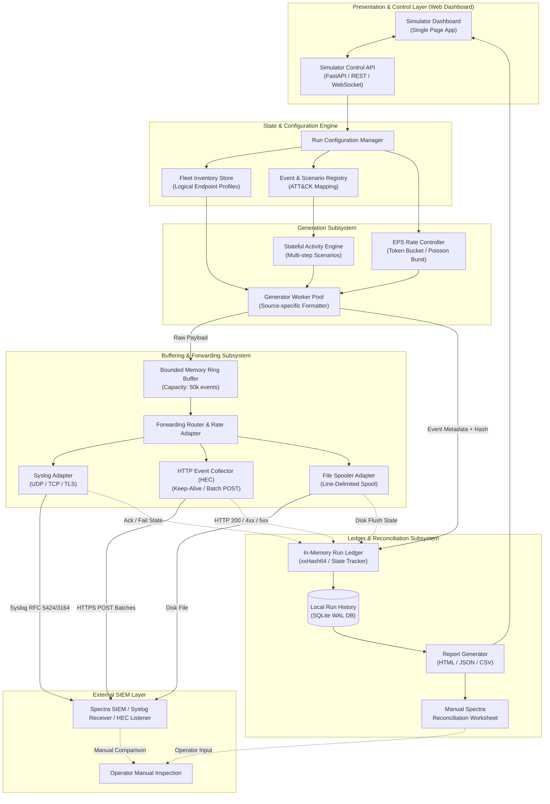
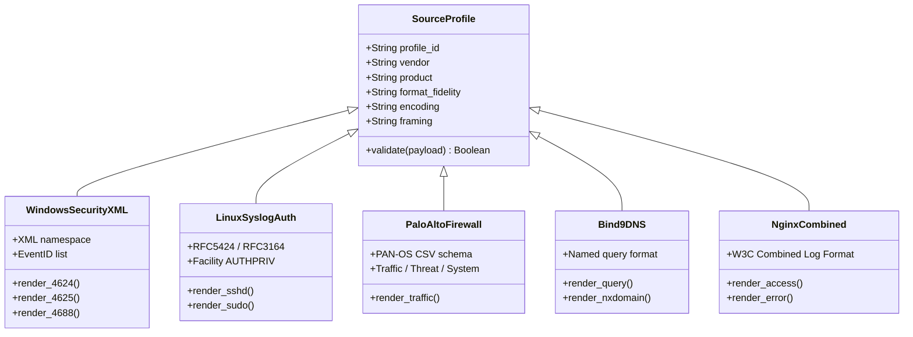
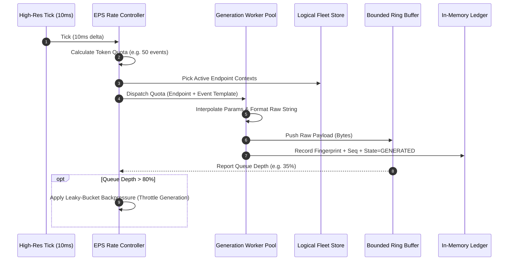
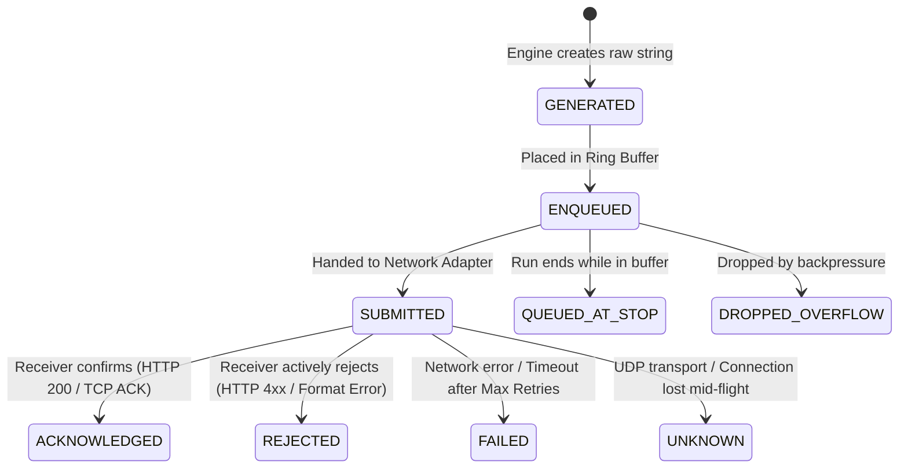

# SOC Telemetry Simulator  — Comprehensive System Architecture & Engineering Design

## 1. Executive Summary & Product Positioning

### 1.1 Product Mission
The **SOC Telemetry Simulator ** is an enterprise-grade, standalone security log generation and SIEM ingestion test platform. It synthesizes high-volume, realistic, source-faithful raw telemetry representing hundreds of heterogeneous logical endpoints (workstations, servers, firewalls, routers, DNS, web, databases, and VPNs) and forwards that telemetry to a SIEM destination (**Spectra**) to validate ingestion capacity, parsing accuracy, and detection efficacy.

### 1.2 Strict Product Boundaries
* **Telemetry Generator, Not a SIEM:** The simulator generates, buffers, and forwards logs. It maintains an internal ledger for auditing its own actions but does not parse, correlate, or index telemetry as a SIEM.
* **Ingestion Test Tool, Not an Attack Framework:** Suspicious scenarios synthesize realistic log trails (aligned with MITRE ATT&CK techniques) without executing destructive exploits, credential theft, malware execution, or network packet injection.
* **Separation of Simulator vs. SIEM Truth:** The simulator accounts only for *Generated, Enqueued, Submitted, Acknowledged (protocol-level), Rejected, Failed, and Queued* events. It **never claims** that Spectra ingested, indexed, or detected an event. Manual verification via an end-of-run reconciliation worksheet bridges the simulator ground truth with Spectra SIEM output.
* **Zero Containerization in Scope:** The system runs directly on a Windows host without Docker, Kubernetes, or hypervisor virtualization.
* **No Speculative Spectra APIs:** The forwarding layer uses configurable, industry-standard transports (Syslog RFC 5424/3164 over UDP/TCP/TLS, Splunk-compatible HTTP Event Collector [HEC], and line-delimited File Spooling) without fabricating proprietary Spectra endpoints.

---

## 2. Core Technical Challenges & Architectural Resolutions

### Challenge 1: Realistic Windows Event Logs vs. Forwarder Ingestion
* **The Problem:** True Windows Event Logs (`.evtx`) are binary structures maintained exclusively by the local Windows Event Log service (`wevtapi.dll`). Tools like Winlogbeat read live Windows Event Channels directly via OS APIs. If a simulator emits raw XML or text files, Winlogbeat cannot ingest them as native EVTX channels. Writing to local OS channels via Windows APIs requires `SeAuditPrivilege`, pollutes the host OS, and prevents simulating hundreds of remote hostnames and IP addresses.
* **The Architectural Resolution:**
  1. Classify Windows telemetry as **"Native-Format Compatible (Conformant Windows Event XML)"**.
  2. Implement the official Microsoft XML Event Schema (`http://schemas.microsoft.com/win/2004/08/events/event`) including exact `<System>` provider/event ID/keywords and `<EventData>` key-value structures.
  3. Direct-ship Windows XML payloads over **Splunk HEC** (`/services/collector/raw` or `/services/collector/event` with `sourcetype=xml_wineventlog`) or **RFC 5424 Syslog with octet-framing**, or write to a **Filebeat-monitored file spooler**.
  4. The UI and final report strictly document this format fidelity label so operators understand the transport path.

### Challenge 2: Simulating Hundreds of Endpoints on a Single Windows PC
* **The Problem:** The host machine is a Windows 11 desktop (Intel Core i5, 16 GB RAM, 512 GB SSD). Running 100+ virtual machines or containers is impossible.
* **The Architectural Resolution:**
  1. Decouple *device identity* from *execution thread*. A **Logical Endpoint** is a lightweight stateful data model (~2 KB memory per endpoint) containing identity metadata (hostname, MAC, IP from reserved subnets, OS profile, role, active sessions, process IDs).
  2. A single high-performance generation engine multiplexes event synthesis across the entire fleet of hundreds of logical endpoints using round-robin and weighted probability scheduling.

### Challenge 3: Preserving Raw Native Fidelity while Tracking Event Provenance
* **The Problem:** In SIEM testing, the operator must know which events were generated, their timestamps, and attack classifications. However, injecting artificial fields (like `simulator_id` or `mitre_tag`) into raw Syslog, Windows XML, or firewall logs corrupts parsing and violates source realism.
* **The Architectural Resolution:**
  1. **Strict Payload Sanctity:** Native event payloads are generated 100% cleanly without synthetic tracking annotations.
  2. **Zero-Invasion Provenance via In-Memory Ring Ledger:** For every event generated, the engine extracts a 64-bit non-cryptographic fingerprint (`xxHash64`) of the raw payload plus a monotonic sequence counter and stores it in an internal memory-mapped run ledger alongside the metadata (`endpoint_id`, `timestamp`, `event_type`, `scenario_id`, `delivery_status`).
  3. Where RFC 5424 Syslog is explicitly configured, an optional custom structured data element (`[meta@simulator run_id="..." seq="..."]`) can be toggled by the operator.

### Challenge 4: High-Volume Generation without Memory Exhaustion or Forwarding Bottlenecks
* **The Problem:** A fast generator can produce 5,000+ EPS, but destination network latency or Spectra ingestion backpressure could cause unbounded queue growth, leading to an Out-Of-Memory (OOM) crash on a 16 GB system.
* **The Architectural Resolution:**
  1. **Bounded Ring Buffer Queue:** Forwarding queues are strictly size-capped (e.g., max 50,000 events or 128 MB RAM).
  2. **Reactive Leaky-Bucket Rate Limiter & Generator Backpressure:** When queue depth exceeds 80%, generator threads automatically throttle down (backpressure signal). If the queue reaches 100%, an operator-configured policy triggers: either *Generator Pause* (strict lossless testing) or *Drop Oldest / Drop Newest* (lossy stress testing), with drops explicitly tallied in the ledger.
  3. **High-Resolution Tick Scheduler:** Event pacing is driven by a 10 ms token bucket timer, preventing burst clumpiness and CPU thread starvation.

---

## 3. System Architecture & Component Decomposition



### Component Responsibilities Matrix

| Component | Responsibility | Failure/Constraint Handling |
| :--- | :--- | :--- |
| **Simulator Control API & Dashboard** | Provides Web UI, real-time WebSocket telemetry, preflight verification, and run controls (Start, Pause, Drain-Stop, Abort). | Runs on local host port (e.g., `8000`); strictly binds to `127.0.0.1` for local safety. |
| **Fleet Inventory Store** | Manages logical endpoint identities, subnet IP allocation, hostname generation, and active state (sessions, process IDs). | Validates IP uniqueness within subnets; rejects duplicate hostnames or invalid CIDR boundaries. |
| **Scenario & Event Registry** | Houses parameterizable templates for normal activity and multi-step MITRE ATT&CK attack scenarios. | Ensures templates comply with source-specific schemas and prevents illegal field syntax. |
| **EPS Scheduler & Rate Controller** | Computes per-tick (10 ms) event quotas using a leaky bucket algorithm; distributes quotas across active endpoints and source types. | Senses downstream queue saturation and exerts immediate backpressure on generator loops. |
| **Generation Engine Pool** | Concurrently synthesizes formatted raw strings from templates, interpolating endpoint context and realistic parameters. | Uses pre-compiled string formatters and fast pseudo-random generators (`PCG-XSH-RR` or seeded Mersenne Twister). |
| **Bounded Ring Buffer** | Holds generated raw payloads awaiting network transmission. | Enforces strict memory limits (configurable 10k–100k events); rejects or blocks upstream generation on overflow. |
| **Forwarding Router & Adapters** | Ships raw batches across Syslog (UDP/TCP/TLS), Splunk HEC (HTTP/S), or File Spooler. Tracks connection state. | Handles TCP keep-alives, HTTP batch pooling (up to 500 events or 256 KB per request), exponential retry backoff. |
| **Run Ledger & Accounting Engine**| Tracks lifecycle states (`GENERATED`, `ENQUEUED`, `SUBMITTED`, `ACKNOWLEDGED`, `REJECTED`, `FAILED`, `UNKNOWN`) keyed by fingerprint. | Persists run statistics to SQLite in WAL mode; payloads are ephemeral to protect disk space. |
| **Report Generator & Reconciliation**| Compiles immutable post-run reports (HTML, JSON, CSV) and renders the blank Spectra Manual Comparison Worksheet. | Generates cryptographic run checksums; flags aborted or partial runs without inventing missing data. |

---

## 4. Logical Endpoint & Virtual Fleet Model

### 4.1 Logical Endpoint Definition
A **Logical Endpoint** is a persistent data structure simulating a distinct enterprise node. It does not spawn operating system threads or background processes.

```json
{
  "endpoint_id": "EP-WIN-WKS-0042",
  "hostname": "WKS-FIN-042.corp.local",
  "domain": "CORP.LOCAL",
  "ip_address": "10.100.12.42",
  "mac_address": "00:50:56:A1:2B:42",
  "device_family": "Windows",
  "os_profile": "Windows 11 Enterprise 23H2 (Build 22631.3007)",
  "role": "Workstation",
  "department": "Finance",
  "active_users": [
    {
      "username": "sarah.connor",
      "user_sid": "S-1-5-21-3623811015-3361044348-30300820-1142",
      "logon_id": "0x19F4B2",
      "logon_time": "2026-11-12T08:15:30Z"
    }
  ],
  "enabled_sources": ["windows_security_xml", "windows_sysmon"],
  "assigned_eps_weight": 1.2,
  "state_variables": {
    "current_pid_counter": 4820,
    "current_logon_guid": "{a8f110c4-98b1-4f4d-bc12-d98c21a44e10}"
  }
}
```

### 4.2 Realistic Enterprise Network & IP Subnet Allocation
To prevent IP collisions and mirror genuine enterprise network architectures, the simulator uses standard private RFC 1918 allocations partitioned into functional zones:

| Zone / Role | Subnet CIDR | Simulated Gateway | Default Device Profiles |
| :--- | :--- | :--- | :--- |
| **User Workstations (DHCP)** | `10.100.0.0/16` | `10.100.0.1` | Windows 10/11 Enterprise, Ubuntu Desktop 22.04 |
| **Corporate Windows Servers**| `10.200.10.0/24`| `10.200.10.1`| Windows Server 2022 (Domain Controllers, File Servers) |
| **Linux Production Infrastructure**| `10.200.20.0/24`| `10.200.20.1`| RHEL 9.3, Ubuntu Server 22.04 LTS, Debian 12 |
| **Database Tier (Isolated)** | `10.200.30.0/24`| `10.200.30.1`| PostgreSQL 16 on RHEL, Oracle 19c, MS SQL Server 2022 |
| **DMZ / Web Reverse Proxies**| `172.16.10.0/24` | `172.16.10.1` | NGINX 1.24, Apache Traffic Server, Envoy |
| **Perimeter Firewalls & Routers**| `192.168.1.0/24` | `192.168.1.1` | Palo Alto PAN-OS 11.0, Cisco IOS-XE 17.9 |
| **VPN & Identity Gateways** | `172.20.0.0/16` | `172.20.0.1` | WireGuard / OpenVPN Access Server, FreeRADIUS |
| **Internet / External Attacker (Safe)**| `198.51.100.0/24`| N/A | RFC 5737 TEST-NET-2 (Public test space for C2 / Scanners) |

### 4.3 Fleet Generation Mechanics
* **Bulk Fleet Builder:** The operator specifies total endpoints (e.g., 100) and percentage distributions (e.g., 60% Workstations, 20% Linux Servers, 10% Firewalls, 5% Web, 5% DB).
* **Deterministic Seeding:** When a random seed is provided, identical IP addresses, hostnames, SIDs, and MAC addresses are assigned across runs, allowing reproducible SIEM correlation tests.

---

## 5. Log Source Catalog & Priority 1–6 Format Specifications

Every source format adheres strictly to its documented schema, timestamp formatting, line framing, and severity conventions.



### Priority 1: Linux Authentication & System Logs
* **Fidelity Label:** `Native-format compatible (RFC 5424 / RFC 3164 syslog)`
* **Framing & Encoding:** UTF-8, Line-delimited (`\n`) or Octet-counted.
* **Timestamp Format:** RFC 3164 (`MMM d HH:mm:ss`) or RFC 5424 (`YYYY-MM-DDTHH:mm:ss.ffffff+00:00`).
* **Golden Sample Records:**
  * *Successful SSH Login (RFC 3164):*
    ```syslog
    <86>Nov 12 01:14:22 srv-prod-db01 sshd[14298]: Accepted publickey for dbadmin from 10.100.12.42 port 54822 ssh2: RSA SHA256:4xJzL8...
    ```
  * *Failed SSH Password Attempt (RFC 5424):*
    ```syslog
    <85>1 2026-11-12T01:14:25.102341Z srv-prod-app02 sshd 14310 - [auth@41058 failure_reason="invalid_password" attempt="3"] Failed password for invalid user admin from 198.51.100.45 port 41208 ssh2
    ```
  * *Sudo Command Execution:*
    ```syslog
    <85>Nov 12 01:15:02 srv-prod-web01 sudo[15120]:   secops : TTY=pts/1 ; PWD=/home/secops ; USER=root ; COMMAND=/bin/systemctl restart nginx
    ```

### Priority 2: Windows Security & System Logs
* **Fidelity Label:** `Native-format compatible (Windows Event XML Schema 2004/08)`
* **Framing & Encoding:** UTF-8, Well-formed XML Document fragment, Single-line or compact XML.
* **Golden Sample Record (Event ID 4625 - Failed Logon):**
```xml
<Event xmlns="http://schemas.microsoft.com/win/2004/08/events/event">
  <System>
    <Provider Name="Microsoft-Windows-Security-Auditing" Guid="{54849625-5478-4994-A5BA-3E3B0328C30D}" />
    <EventID>4625</EventID>
    <Version>0</Version>
    <Level>0</Level>
    <Task>12544</Task>
    <Opcode>0</Opcode>
    <Keywords>0x8010000000000000</Keywords>
    <TimeCreated SystemTime="2026-11-12T01:15:32.418902Z" />
    <EventRecordID>1048291</EventRecordID>
    <Correlation ActivityID="{D8B281A4-7123-41D8-92A1-80C428198A2B}" />
    <Execution ProcessID="688" ThreadID="1920" />
    <Channel>Security</Channel>
    <Computer>DC01.corp.local</Computer>
    <Security />
  </System>
  <EventData>
    <Data Name="SubjectUserSid">S-1-5-18</Data>
    <Data Name="SubjectUserName">DC01$</Data>
    <Data Name="SubjectDomainName">CORP</Data>
    <Data Name="SubjectLogonId">0x3E7</Data>
    <Data Name="TargetUserSid">S-1-0-0</Data>
    <Data Name="TargetUserName">aditya.admin</Data>
    <Data Name="TargetDomainName">CORP</Data>
    <Data Name="Status">0xC000006D</Data>
    <Data Name="FailureReason">%%2313</Data>
    <Data Name="SubStatus">0xC000006A</Data>
    <Data Name="LogonType">3</Data>
    <Data Name="LogonProcessName">NtLmSsp</Data>
    <Data Name="AuthenticationPackageName">NTLM</Data>
    <Data Name="WorkstationName">WKS-FIN-042</Data>
    <Data Name="TransmittedServices">-</Data>
    <Data Name="LmPackageName">-</Data>
    <Data Name="KeyLength">0</Data>
    <Data Name="ProcessId">0x0</Data>
    <Data Name="ProcessName">-</Data>
    <Data Name="IpAddress">10.100.12.42</Data>
    <Data Name="IpPort">58412</Data>
  </EventData>
</Event>
```

### Priority 3: Perimeter Firewalls & Routers
* **Fidelity Label:** `Vendor-style profile (Palo Alto PAN-OS 10.x/11.x Traffic CSV & Cisco ASA Syslog)`
* **Framing & Encoding:** ASCII/UTF-8, Line-delimited (`\n`).
* **Golden Sample Records:**
  * *Palo Alto PAN-OS Traffic Allow Log:*
    ```csv
    1,2026/11/12 01:16:01,001801004215,TRAFFIC,drop,2304,2026/11/12 01:16:01,198.51.100.88,172.16.10.15,0.0.0.0,0.0.0.0,External-Drop,,,web-browsing,vsys1,untrust,dmz,ethernet1/1,ethernet1/2,Forward-All,2026/11/12 01:16:01,0,1,51420,80,0,0,0x0,tcp,deny,60,0,0,1,2026/11/12 01:16:01,0,any,0,1082910,0x0,198.51.100.0-24,US,0,1,0,policy-deny,0,0,0,0,,PA-Perimeter-FW01,from-policy
    ```
  * *Cisco ASA Deny Connection (Syslog):*
    ```syslog
    <164>%ASA-4-106023: Deny tcp src untrust:198.51.100.77/49152 dst dmz:172.16.10.10/443 by access-group "OUTSIDE-IN" [0x0, 0x0]
    ```

### Priority 4: Enterprise DNS Servers
* **Fidelity Label:** `Native-format compatible (BIND9 query log & Windows DNS Analytical)`
* **Golden Sample Record (BIND9 Query & NXDOMAIN):**
  ```syslog
  12-Nov-2026 01:17:15.891 client @0x7f481014a000 10.100.12.42#51920 (beacon-c2-xyz.attacker-domain.cc): query: beacon-c2-xyz.attacker-domain.cc IN A + (10.200.10.2)
  12-Nov-2026 01:17:15.912 client @0x7f481014a000 10.100.12.42#51921 (random-dga-091a4b.biz): query: random-dga-091a4b.biz IN A + (10.200.10.2) NXDOMAIN
  ```

### Priority 5: Web Servers & Reverse Proxies
* **Fidelity Label:** `Generic standard (W3C Combined Log Format & NGINX JSON)`
* **Golden Sample Record (NCSA/Combined):**
  ```accesslog
  10.100.12.42 - sarah.connor [12/Nov/2026:01:17:45 +0000] "GET /api/v1/payroll/summary HTTP/1.1" 200 4821 "https://portal.corp.local/dashboard" "Mozilla/5.0 (Windows NT 10.0; Win64; x64) AppleWebKit/537.36"
  ```
  *Suspicious Directory Traversal Probe:*
  ```accesslog
  198.51.100.99 - - [12/Nov/2026:01:18:02 +0000] "GET /../../../../etc/passwd HTTP/1.1" 400 166 "-" "sqlmap/1.7.2#stable"
  ```

### Priority 6: Databases, Identity & VPN Gateways
* **Fidelity Label:** `Vendor-style profile (PostgreSQL CSVLog & WireGuard / FreeRADIUS Auth)`
* **Golden Sample (PostgreSQL Connection & Privilege Escalation):**
  ```csv
  2026-11-12 01:18:30.120 UTC,"secops","app_production",18420,"10.200.20.14:48102",65502,"idle",2026-11-12 01:18:25 UTC,3/140,0,LOG,00000,"statement: ALTER ROLE app_user WITH SUPERUSER;",,,,,,,,,"psql"
  ```

---

## 6. Event Generation & High-Volume EPS Scheduling Engine

### 6.1 Generation Architecture
To achieve deterministic throughput without bursting or jitter, generation utilizes a dual-engine architecture:
1. **Ambient Baseline Generator (Poisson Process):** Simulates standard business activity (normal logins, routine web lookups, DNS queries, firewall allows).
2. **Deterministic Campaign Orchestrator (State Machines):** Drives correlated, multi-step suspicious sequences where step $N+1$ depends on the entity context of step $N$.



### 6.2 Rate Allocation Algorithm
The total operator-configured target EPS ($EPS_{target}$) is partitioned hierarchically:
$$EPS_{source} = EPS_{target} \times W_{source}$$
Where $\sum W_{source} = 1.0$.

For each source family, the rate is distributed across assigned endpoints according to their individual weight $w_{endpoint}$:
$$EPS_{endpoint} = EPS_{source} \times \frac{w_{endpoint}}{\sum w_{i}}$$

Every 10 milliseconds, the scheduler releases tokens:
$$Tokens_{tick} = \frac{EPS_{target}}{100}$$
If fractional tokens accumulate, they are preserved via a Bresenham accumulator to prevent rate drift.

### 6.3 Resource-Constrained Backpressure & Drop Policy
To ensure stable execution on the Windows 11 host (16 GB RAM), the queue has three strict thresholds:
* **Normal Operation (Queue Depth < 70%):** Generation and forwarding operate at full speed.
* **Throttling (70% - 95%):** Generator sleep intervals increase dynamically; EPS is throttled to match observed network submission throughput.
* **Saturated (95% - 100%):** Triggers the configured Overflow Policy:
  * *Strict Policy (Default):* Generator completely halts until queue drains below 50%. Zero data loss; generated count equals submitted count.
  * *Lossy / Stress Policy:* Generator drops newest events, incrementing `queue_dropped_count` in the ledger without forwarding.

---

## 7. Suspicious Activity Catalog & MITRE ATT&CK Framework Mapping

All suspicious activity is mapped to the MITRE ATT&CK Enterprise Matrix (v14.1).

| Scenario ID | ATT&CK Tactic | ATT&CK Technique | Primary Source Profiles | Coherent Multi-Step Event Sequence |
| :--- | :--- | :--- | :--- | :--- |
| **SCEN-AUTH-BRUTE** | Credential Access | **T1110.001** (Password Guessing) | Linux `auth.log` or Windows Security (4625) | 15x failed logins across 3 minutes against user `admin` from IP `198.51.100.45`, followed by 1x Event 4624 (Logon Success). |
| **SCEN-RECON-PORT** | Discovery | **T1046** (Network Service Discovery) | Palo Alto Traffic / Cisco ASA Syslog | 50x sequential TCP SYN drops across destination ports 21, 22, 23, 80, 443, 445, 3389, 8080 from single untrusted source. |
| **SCEN-DNS-C2** | Command and Control | **T1071.004** (DNS C2 Beaconing) | BIND9 DNS Query Log | Periodic (60s jittered) TXT/A query lookups for randomized subdomains under high-entropy domain (`*.darkmesh-c2.cc`). |
| **SCEN-PRIV-ESCAL** | Privilege Escalation | **T1078.002** (Domain Accounts) & **T1098** | Windows Security XML (4720, 4728, 4672) | Account created (`4720`) -> Added to Domain Admins (`4728`) -> Immediate logon with Special Privileges (`4672`). |
| **SCEN-PROC-INJECT**| Defense Evasion | **T1059.001** (PowerShell) | Windows Sysmon / Security (4688) | `powershell.exe` spawned by `winword.exe` with base64 encoded command arguments (`-enc JAB...`). |
| **SCEN-DATA-EXFIL** | Exfiltration | **T1048** (Exfiltration Over Alternative Protocol) | Web Proxy / Firewall Traffic | Outbound HTTPS POST burst of 50 MB to unusual external IP in non-business hours followed by session termination. |

### Configurable Normal-to-Suspicious Ratio
The operator configures a clean slider: **Normal % vs. Suspicious %** (e.g., 95% Normal, 5% Suspicious). The engine enforces this ratio globally and per-endpoint.

---

## 8. Forwarding, Queuing & Spectra Destination Architecture

### 8.1 Zero-Invention Destination Integration Model
The simulator treats Spectra as an external receiver reachable via industry-standard protocols. The operator configures standard network destination parameters:

```json
{
  "destination_id": "DEST-SPECTRA-PRIMARY",
  "destination_name": "Spectra SIEM Cluster",
  "transport_type": "splunk_hec",
  "endpoint_url": "https://spectra-ingest.corp.local:8088/services/collector/raw",
  "auth_header_type": "Bearer",
  "auth_token_secret_ref": "SEC_SPECTRA_TOKEN_01",
  "tls_verify_certificate": true,
  "tls_ca_bundle_path": "C:\\Certs\\corp-ca.pem",
  "connection_timeout_ms": 3000,
  "request_timeout_ms": 5000,
  "batch_size_events": 250,
  "batch_size_bytes": 131072,
  "batch_flush_interval_ms": 250,
  "max_retries": 3,
  "retry_backoff_base_ms": 500
}
```

### 8.2 Transport Adapters

| Adapter Type | Protocol / Method | Batching & Framing Support | Acknowledgement Semantics |
| :--- | :--- | :--- | :--- |
| **Syslog UDP** | UDP socket (port 514) | Single message per datagram; RFC 5424 octet or newline framing. | **Unacknowledged:** OS socket send confirms submission only (`SUBMITTED`). Acknowledged count remains 0. |
| **Syslog TCP / TLS** | Streaming TCP / TLS socket (ports 514/6514) | Keep-alive socket; octet-counting framing (`<length> <message>`). | **Socket Acknowledged:** Kernel TCP ACK confirms delivery to receiver buffer. |
| **Splunk HEC (HTTP/S)** | HTTP POST `/services/collector/raw` or `/event` | Gzip-compressed batches (up to 500 events); HTTP/1.1 Keep-Alive pool. | **Application Acknowledged:** HTTP 200 OK with `{"text":"Success","code":0}` confirms receiver accepted batch. |
| **File Spooler** | Atomic rolling files on local disk | Pre-allocated files (e.g., 50 MB chunks) with `.tmp` -> `.log` rename. | **Storage Acknowledged:** Confirmed OS `fsync()` to disk. |

### 8.3 Exact Delivery Accounting Lifecycle



* **Important Accounting Invariant:** Retries increment `retry_attempts` but **never create duplicate event records** in the ledger.

---

## 9. Run Ledger, Accounting Database & Reporting Specifications

### 9.1 In-Memory Ring Ledger & Persistence Schema
The system maintains an in-memory ledger during the run for extreme speed. At the end of the run (or periodically during long runs), aggregate counters and sample records are committed to an embedded SQLite database (`soc_simulator.db`) using Write-Ahead Logging (WAL).

```sql
-- High-Level Run Summary Table
CREATE TABLE run_summary (
    run_id TEXT PRIMARY KEY,
    run_name TEXT NOT NULL,
    start_time TEXT NOT NULL,
    end_time TEXT,
    duration_seconds REAL,
    status TEXT NOT NULL, -- COMPLETED, STOPPED, FAILED, PARTIAL
    simulator_version TEXT NOT NULL,
    config_snapshot_json TEXT NOT NULL,
    random_seed INTEGER,
    total_generated INTEGER NOT NULL,
    total_normal INTEGER NOT NULL,
    total_suspicious INTEGER NOT NULL,
    total_enqueued INTEGER NOT NULL,
    total_submitted INTEGER NOT NULL,
    total_acknowledged INTEGER NOT NULL,
    total_rejected INTEGER NOT NULL,
    total_failed INTEGER NOT NULL,
    total_unknown INTEGER NOT NULL,
    total_retries INTEGER NOT NULL,
    avg_generated_eps REAL,
    peak_generated_eps REAL
);

-- Aggregated Breakdown by Source and Event Type
CREATE TABLE run_breakdown (
    run_id TEXT NOT NULL,
    source_family TEXT NOT NULL,
    profile_id TEXT NOT NULL,
    event_id_or_type TEXT NOT NULL,
    classification TEXT NOT NULL, -- NORMAL / SUSPICIOUS
    scenario_id TEXT,
    generated_count INTEGER NOT NULL,
    acknowledged_count INTEGER NOT NULL,
    failed_count INTEGER NOT NULL,
    PRIMARY KEY (run_id, profile_id, event_id_or_type, scenario_id),
    FOREIGN KEY (run_id) REFERENCES run_summary(run_id)
);
```

### 9.2 End-of-Run Final Simulator Report
Every run produces an exportable HTML and JSON report package containing:
1. **Header & Provenance:** Run ID, software version, exact seed, redacted destination config.
2. **Generation KPI Scorecard:** Total Events, Normal vs. Suspicious, Target vs. Observed EPS.
3. **Delivery Funnel:** Generated $\rightarrow$ Enqueued $\rightarrow$ Submitted $\rightarrow$ Acknowledged / Rejected / Failed / Unknown.
4. **Source Family & Event ID Breakdown Table:** Complete reconcilable tally.
5. **MITRE ATT&CK Scenario Audit:** Specific timestamps, target endpoints, event sequences, and hash references for every attack simulation.
6. **The Manual Spectra Reconciliation Worksheet:** A dedicated comparative ledger for manual SIEM verification.

### 9.3 Manual Spectra Reconciliation Worksheet
Because this version does not query Spectra automatically, the report provides an operator verification worksheet:

| Verification Metric | Simulator Ground Truth | Spectra SIEM Observed Value | Delta (Discrepancy) | Reconciliation Notes & Root Cause Analysis |
| :--- | :--- | :--- | :--- | :--- |
| **Total Event Count** | `100,000` | *(Operator fills in)* | *(Auto-calculated in UI)* | *(e.g. Parser drop, index lag, network loss)* |
| **Windows Security (4624)** | `35,000` | *(Operator fills in)* | | |
| **Windows Security (4625)** | `5,000` | *(Operator fills in)* | | |
| **Linux Auth (sshd)** | `20,000` | *(Operator fills in)* | | |
| **Firewall Traffic (Allow)** | `30,000` | *(Operator fills in)* | | |
| **Firewall Traffic (Deny)** | `5,000` | *(Operator fills in)* | | |
| **DNS Query Volume** | `5,000` | *(Operator fills in)* | | |
| **Suspicious Scenario Events**| `5,000` | *(Operator fills in)* | | |
| **MITRE T1110 (Brute Force)** | `15 failed + 1 ok` | *(Operator fills in)* | | *(Did Spectra trigger Alert Rule SEC-042?)*|
| **MITRE T1046 (Port Scan)** | `50 deny events` | *(Operator fills in)* | | *(Did Spectra fire Port Scan rule?)* |

---

## 10. User Experience & Dashboard Interface Design

The UI is designed as a clean, responsive single-page web application.

```
+----------------------------------------------------------------------------------------------------+
|  SOC TELEMETRY SIMULATOR               [Status: IDLE]   [Fleet: 100 Endpoints]   [Dest: Spectra] |
+----------------------------------------------------------------------------------------------------+
| [Overview]  |  [Fleet Management]  |  [Event Catalog]  |  [Run Config]  |  [Live Monitor]  | [Reports] |
+----------------------------------------------------------------------------------------------------+
|                                                                                                    |
|  RUN CONFIGURATION & PREFLIGHT                                                                     |
|                                                                                                    |
|  1. Environment & Fleet: [ Enterprise Baseline Fleet (100 Endpoints)                  [v] ]        |
|     * 60x Windows Workstations   * 20x Linux Servers   * 10x Firewalls   * 10x Web/DNS/DB          |
|                                                                                                    |
|  2. Target Throughput (EPS):                                                                       |
|     [========================O==================]  1,000 EPS  (Range: 10 - 10,000 EPS)              |
|                                                                                                    |
|  3. Activity Mix:                                                                                  |
|     Normal Events: [ 95% ]   Suspicious (MITRE ATT&CK): [  5% ]   (Must total 100%)                |
|                                                                                                    |
|  4. Active Suspicious Scenarios:                                                                   |
|     [X] T1110.001 SSH/RDP Brute Force                   [X] T1046 Network Service Port Scanning    |
|     [X] T1071.004 Suspicious DNS C2 Beaconing           [ ] T1059.001 Obfuscated PowerShell Spawn  |
|                                                                                                    |
|  5. Destination & Shipping Profile:                                                                |
|     Destination: [ Spectra Production HEC (Port 8088)                                 [v] ]        |
|     [ Run Preflight Connectivity Check ] -> [ OK: HTTP 200 in 14ms ]                               |
|                                                                                                    |
|  6. Duration & Seed:                                                                               |
|     Duration: [ 300 ] Seconds (5 min)    Random Seed: [ 420914        ] [X] Deterministic Mode     |
|                                                                                                    |
|  +----------------------------------------------------------------------------------------------+  |
|  | PREFLIGHT VERIFICATION:                                                                       |  |
|  |  [PASSED] Fleet IP collision check: 100 unique addresses across 4 subnets                    |  |
|  |  [PASSED] Schema validation: 14 selected event templates valid                               |  |
|  |  [PASSED] Destination reachability: TCP 8088 reachable, TLS cert valid                       |  |
|  |  [PASSED] Host resource budget: Estimated memory overhead 320 MB (Safe on 16 GB host)       |  |
|  +----------------------------------------------------------------------------------------------+  |
|                                                                                                    |
|               [ START TELEMETRY SIMULATION RUN ]       [ Save Configuration ]                      |
+----------------------------------------------------------------------------------------------------+
```

### Live Run Monitor Layout
When a run begins, the view switches to the **Live Monitor**:
* **Top KPI Bar:** Elapsed / Remaining Time, Active Run ID, Current Generated EPS (Gauge), Forwarding Queue Depth (Bar).
* **Live Charts (WebSocket Stream):**
  * Time-series Chart 1: *Target EPS vs. Actual Generated EPS vs. Submitted EPS*.
  * Time-series Chart 2: *Queue Fill Level (0–100%) & Network Submission Latency (ms)*.
* **Breakdown Panels:**
  * Dynamic counter by Source Family (Windows, Linux, Firewall, DNS, Web).
  * Delivery state badges: `Submitted: 45,200` | `Acknowledged: 44,900` | `Retrying: 12` | `Failed: 0`.
* **Controls:** `[ Pause Generation ]`, `[ Drain & Stop Gracefully ]`, `[ Immediate Abort ]`.

---

## 11. Security, Operational Constraints & Resource Management

### 11.1 Target Hardware Constraints (Windows 11, Core i5, 16 GB RAM)
* **Memory Ceiling:** The simulator enforces a hard process memory budget of **2.0 GB RAM**. If working memory exceeds 1.5 GB, backpressure immediately halts new queue insertions.
* **Disk Safety:** Payload strings are generated in volatile memory, streamed to network buffers, and garbage-collected. The SQLite run ledger records only fingerprints and counts, ensuring a 1,000,000-event run consumes $<50$ MB of disk space.
* **CPU Polling Avoidance:** Generation sleep pacing uses high-resolution OS waitable timers rather than busy-wait spinlocks, keeping background CPU load $<35\%$ on a Core i5.

### 11.2 Safe Operating Sandbox & Network Boundaries
* **Reserved Test IPs Only:** All simulated source and destination IPs outside internal subnets strictly utilize RFC 5737 (`198.51.100.0/24`, `203.0.113.0/24`) or RFC 3849 (`2001:db8::/32`). Real public IP addresses are forbidden.
* **Secret Redaction:** Destination tokens, passwords, and TLS private keys are stored in a dedicated local encrypted configuration vault (`secrets.json` with DPAPI encryption on Windows). In exported reports and dashboard logs, tokens are masked (`Bearer eyJh...****`).
* **Strict Egress Whitelist:** Outbound traffic from the simulator process is restricted exclusively to the operator-configured destination host and port.

---

## 12. Testing Strategy & Acceptance Criteria

### 12.1 Format Fidelity & Schema Verification Suite
Before any source profile is certified, it passes automated unit tests:
1. **Schema Linter:** Windows XML validated against official Microsoft XSD; Syslog validated against RFC 5424 BNF grammar; CSV validated against vendor column schemas.
2. **Timestamp Monotonicity:** Verifies timezone consistency (`Z` / UTC) and monotonic sequencing.
3. **Escaping & Framing:** Tests special characters (`<`, `>`, `&`, `"`, control characters) in usernames and paths to guarantee parser resilience.

### 12.2 Throughput & Scalability Benchmark Stages
Testing must be executed on the physical Windows 11 host in 4 progressive stages:

| Stage | Target EPS | Duration | Endpoints | Acceptance Criteria |
| :--- | :--- | :--- | :--- | :--- |
| **Stage 1: Functional Baseline** | 50 EPS | 2 minutes | 10 | Zero errors; 100% schema compliance; perfect delivery accounting. |
| **Stage 2: Sustained Enterprise** | 500 EPS | 15 minutes | 100 | Queue depth $<20\%$; CPU $<20\%$; memory drift $<50$ MB; zero dropped events. |
| **Stage 3: Peak Stress Run** | 2,500 EPS | 5 minutes | 250 | Graceful backpressure engagement; zero process crash; accurate drop tally. |
| **Stage 4: Overnight Soak Test** | 250 EPS | 4 hours | 100 | Stable memory footprint; SQLite WAL checkpointing healthy; clean final report. |

---

## 13. Phased Implementation Roadmap


* **Phase 0: Design & Schema Sign-Off (Current Step)**
  * Formal review of architecture, schemas, and technical trade-offs. Wait for user approval before touching code.
* **Phase 1: Project Setup, Core Engine & In-Memory Fleet**
  * Initialize project directory in `C:\Users\Aditya\.gemini\antigravity\scratch\soc-telemetry-simulator`.
  * Build Logical Endpoint Fleet Manager, CIDR allocator, and High-Resolution Token Bucket EPS scheduler.
* **Phase 2: Source Catalog & Transport Adapters**
  * Implement Priority 1–4 formatters (Linux Auth, Windows XML, Palo Alto CSV, BIND9 DNS).
  * Build Syslog (UDP/TCP) and Splunk HEC HTTP/S forwarding adapters with connection pooling and retry backoff.
* **Phase 3: Suspicious Scenario Engine & In-Memory Run Ledger**
  * Implement multi-step MITRE ATT&CK state machines (Brute Force, Scan, C2 Beacon).
  * Implement high-speed `xxHash64` fingerprinting and SQLite WAL persistence.
* **Phase 4: Dashboard UI & Real-Time Monitoring**
  * Develop lightweight local Web UI (Dashboard, Fleet Builder, Run Configurator, Live Monitor with WebSocket streaming).
* **Phase 5: Reporting, Benchmarking & Final Hardening**
  * Implement HTML/JSON/CSV report generators and the manual Spectra comparison worksheet.
  * Execute 4-stage hardware benchmarks on Windows 11; verify stability and zero-loss guarantees.

---

## 14. Key Technical Decisions & Approvals Required from User

The following explicit technical decisions are submitted for user review and approval before implementation begins:

1. **Technology Stack Selection for Core Engine & UI:**
   * *Option A (Recommended):* **Python 3.11+ / FastAPI backend with asyncio + lightweight React/Vite frontend**. Fast development, rich security log format libraries, excellent Windows 11 compatibility. Easily sustains 1,000–3,000 EPS.
   * *Option B:* **Go (Golang) single-binary service with embedded frontend assets**. Maximum throughput (10,000+ EPS), minimal memory footprint (<100 MB), zero external runtime dependencies on Windows.
2. **First Release Source Scope:**
   * Confirm that the initial MVP includes: **Windows Security XML (IDs 4624, 4625, 4688), Linux Auth/Syslog (RFC 5424/3164 sshd/sudo), Palo Alto PAN-OS Traffic CSV, and BIND9 DNS Query logs**.
3. **Spectra Transport Confirmation:**
   * Confirm that testing Spectra will begin using either standard **Syslog over TCP (RFC 5424)** or **Splunk HEC compatible HTTP/HTTPS**.
4. **Project Directory Confirmation:**
   * Confirm target project location: `C:\Users\Aditya\.gemini\antigravity\scratch\soc-telemetry-simulator`.
