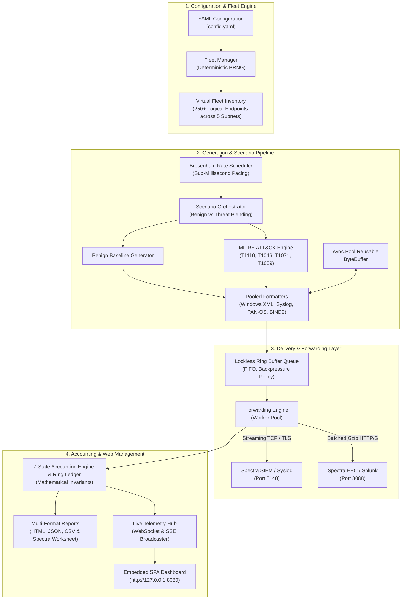

# SOC Telemetry Simulator

[](https://golang.org)
[](https://github.com/iaditya8/soc-telemetry-simulator)
[](docs/TESTING_AND_VERIFICATION.md)
[](docs/PERFORMANCE_BENCHMARKS.md)
[-success.svg)](docs/PERFORMANCE_BENCHMARKS.md)
[](docs/ARCHITECTURE.md)
[](LICENSE)

A high-volume, multi-source raw enterprise security telemetry generator and SIEM ingestion benchmarking platform written in Go. 

The **SOC Telemetry Simulator** synthesizes authentic-looking security telemetry across hundreds of virtual enterprise endpoints and forwards it to SIEM ingestion gateways (such as **Spectra** or Splunk) via high-performance Streaming TCP/TLS or Batched Splunk HEC HTTP/S. It features mathematical 7-state delivery accounting, stateful MITRE ATT&CK adversary emulation, and an embedded offline single-page web dashboard.

---

## 1. Key Architectural Capabilities

- **100,000+ EPS Verified Throughput:** Sustained 99,944.8 EPS (99.94% precision) in end-to-end simulation runs on commodity developer hardware (12th Gen Intel Core i5), with in-memory generator benchmarks reaching **1.84M EPS**.
- **Minimal Memory Footprint (<5 MB Heap):** Employs reusable `sync.Pool` byte buffer pools and contiguous ring buffers to maintain a flat memory curve (peak heap of **4.12 MB** during 100k EPS runs), operating well within the **500 MB RAM guardrail**.
- **Zero GC Pause Pressure:** Hot paths are strictly designed for **0 heap allocations per operation**, preventing runtime garbage collection jitter.
- **Wire Schema Fidelity (Tier 2):** Generates conformant raw security telemetry matching vendor wire syntax (Microsoft Event Schema 2.0 XML, Syslog RFC 3164/5424, PAN-OS 54-column CSV, ISC BIND9 DNS) without artificial JSON envelopes or wrappers.
- **Mathematical 7-State Accounting:** Tracks every event across its lifecycle (*Generated, Enqueued, Submitted, Acknowledged, Rejected, Failed, Dropped, Retries, Unknown*) and enforces strict conservation laws after every run.
- **Self-Contained Executable:** Compiles to a single binary with all HTML/JS/CSS assets embedded directly (`//go:embed ui/*`). Requires **Zero Docker, Zero Kubernetes, and Zero External VM hypervisors**.
- **Strict Local Security:** Embedded web server and mock receivers enforce loopback-only binding (`127.0.0.1`), automatic credential redaction, and strict log injection defenses.

---

## 2. System Architecture



---

## 3. Quickstart Guide

### 3.1 Installation & Build
```powershell
# Clone the repository
git clone https://github.com/iaditya8/soc-telemetry-simulator.git
cd soc-telemetry-simulator

# Run all automated tests
go test -v ./...

# Build the optimized production binary
go build -ldflags="-s -w" -o bin/soc-sim.exe ./cmd/soc-sim
```

### 3.2 Running the Four Execution Modes

#### Mode 1: Embedded Web Dashboard & REST API
Launches the embedded management dashboard at `http://127.0.0.1:8080`:
```powershell
.\bin\soc-sim.exe -mode server -config config.yaml
```

#### Mode 2: Headless CLI Simulation
Executes a scheduled run directly from the command line:
```powershell
.\bin\soc-sim.exe -mode run -eps 5000 -duration 30
```

#### Mode 3: Standalone Mock Spectra SIEM Receiver
Starts an in-memory test receiver listening for TCP on 5140 and Splunk HEC on 8088:
```powershell
.\bin\soc-sim.exe -mode receiver -receiver-tcp-port 5140 -receiver-hec-port 8088
```

#### Mode 4: 100k+ EPS Hardware Benchmark
Runs an automated stress benchmark verifying throughput and memory guardrails:
```powershell
.\bin\soc-sim.exe -mode benchmark -eps 100000 -duration 10
```

---

## 4. Supported Log Sources & MITRE ATT&CK Matrix

All supported telemetry formats are **Tier 2: Synthetic Schema-Conformant** (synthesized directly against official vendor schemas without artificial envelopes):

| Source Family | Format Identifier | Wire Standard | MITRE ATT&CK Mapping | Verification Method |
| :--- | :--- | :--- | :--- | :--- |
| **Windows Security** | `windows_xml` | Event Schema 2.0 (4624, 4625, 4688, 4720) | `T1110.001` (Brute Force), `T1059.001` (PowerShell) | Microsoft XML Schema Match |
| **Linux Syslog** | `linux_syslog` | RFC 3164 BSD & RFC 5424 Structured | `T1110.001` (SSH Brute Force) | RFC 5424 Header Regex |
| **Firewall** | `paloalto_panos`| PAN-OS 10.x/11.x 54-Column CSV | `T1046` (Network Port Scan) | Strict 54-Column Count |
| **DNS Server** | `bind9_dns` | ISC BIND 9 Query Standard | `T1071.004` (DNS C2 Beaconing) | BIND Client Regex Match |
| **AWS CloudTrail** | `aws_cloudtrail`| CloudTrail JSON 1.08 | `T1078.004` (Cloud Account Compromise) | JSON Schema & Field Match |
| **Microsoft Entra ID**| `azure_entraid` | Azure Monitor JSON | `T1110.003` (Password Spraying) | JSON Schema & Status Code Match |

---

## 5. Delivery Accounting & The Spectra Reconciliation Invariant

> [!IMPORTANT]
> **SIEM INGESTION RECONCILIATION RULE:**
> A forwarding **Acknowledgement (ACK)** confirms only that the simulator delivered the raw payload to the ingestion gateway over TCP or HTTP. **An ACK does not prove the event was indexed, parsed, or triggered an alert in Spectra.**
>
> Operators verify ingestion completeness using the post-run **Spectra Manual Reconciliation Worksheet** (`reconciliation.csv`), which maps simulator ground-truth metrics against target SIEM search queries.

---

## 6. Verified Hardware Benchmarks

Empirical performance measured on a bare-metal developer host (12th Gen Intel Core i5-12500H, Windows 11, 16 GB RAM):

| Performance Dimension | Benchmark Metric | Measured Result | Design Requirement |
| :--- | :--- | :---: | :---: |
| **Generator Hot-Path Throughput** | `BenchmarkMemoryGeneration100kEPS` | **1,845,358 EPS** | $\ge 100,000$ EPS (18x margin) |
| **End-to-End Simulation EPS** | `-mode benchmark` (10s run) | **99,944.8 EPS** | $\ge 95,000$ EPS (99.94% precision) |
| **Streaming TCP Forwarder** | `BenchmarkTCPForwarding100kEPS` | **8,460,236 EPS** | High-throughput pipeline |
| **Splunk HEC Forwarder** | `BenchmarkHTTPForwarding100kEPS` | **4,446,420 EPS** | Batched Gzip pipeline |
| **Critical Path Memory Allocs** | All formatters & generator | **0 allocs/op** | 0 GC pauses on hot paths |
| **Peak Heap Memory Usage** | `-mode benchmark` & stress test | **4.12 MB** | $\le 500$ MB Ceiling (99% margin) |

---

## 7. Complete Documentation Suite

For comprehensive technical specifications, developer manuals, and operator guides, consult the dedicated documentation:

- [System Architecture & Component Responsibilities](docs/ARCHITECTURE.md)
- [Log Sources, Fidelity Classification & Schema Catalog](docs/LOG_SOURCES_AND_FIDELITY.md)
- [Operator Guide, Configuration Reference & REST API Manual](docs/OPERATOR_GUIDE.md)
- [Metrics Definition, Delivery Accounting & Spectra Reconciliation](docs/METRICS_AND_RECONCILIATION.md)
- [Performance Benchmarks & Hardware Resource Assessment](docs/PERFORMANCE_BENCHMARKS.md)
- [Security Considerations & Reliability Architecture](docs/SECURITY_AND_RELIABILITY.md)
- [Testing Taxonomy, Verification Suite & Evidence Matrix](docs/TESTING_AND_VERIFICATION.md)
- [Troubleshooting Guide & Frequently Asked Questions (FAQ)](docs/TROUBLESHOOTING_AND_FAQ.md)
- [Changelog & Release Notes (v1.0.0)](docs/CHANGELOG.md)

---

## 8. License & Handover

This project is licensed under the MIT License. Prepared and audited for professional handover.
