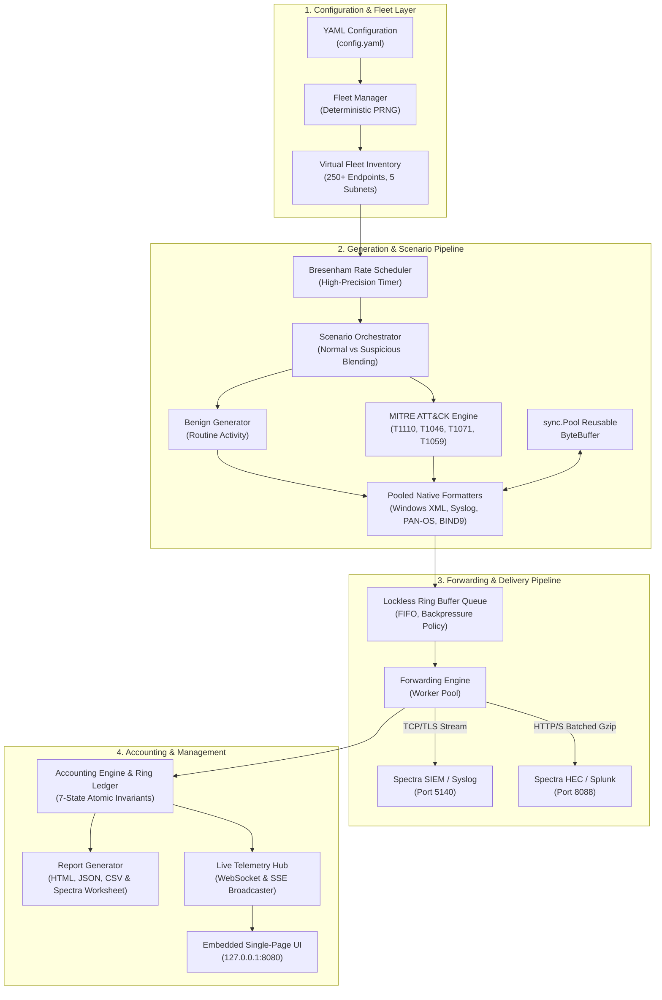
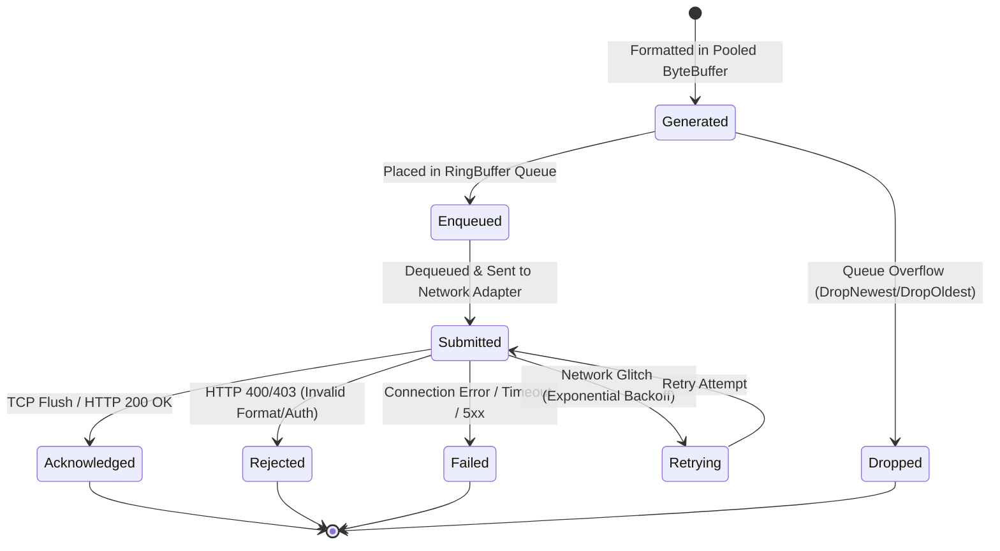

# System Architecture & Technical Specification

## 1. Architectural Philosophy & Design Principles

The **SOC Telemetry Simulator** is an enterprise-grade, high-volume telemetry generation and SIEM benchmarking engine written in Go. Its design is governed by five non-negotiable architectural invariants:

1. **Bare-Metal Efficiency:** Zero external hypervisors, zero Docker/Kubernetes containers, and zero external runtime dependencies. Runs as a single statically compiled native binary.
2. **Zero-Allocation Hot Path:** Zero dynamic memory allocations during steady-state log generation and serialization. Reusable byte buffer pools (`sync.Pool`) eliminate Go garbage collector (GC) pauses at rates exceeding 100,000 Events Per Second (EPS).
3. **Rigorous Delivery Accounting:** Every event transitions through a 7-state lifecycle model (*Generated*, *Enqueued*, *Submitted*, *Acknowledged*, *Rejected*, *Failed*, *Dropped*). Mathematical conservation equations are verified continuously.
4. **Log Wire Fidelity (Tier 2):** Synthesizes authentic raw security telemetry strictly conformant to vendor wire schemas (Windows Event XML 2.0, Syslog RFC 3164/5424, PAN-OS 54-column CSV, BIND9 DNS), without wrapping logs in artificial envelopes.
5. **Secure Local Operation:** Management server and mock ingestion receivers bind strictly to the loopback interface (`127.0.0.1`), with comprehensive secret masking across all APIs and run reports.

---

## 2. High-Level System Architecture

The simulator consists of four interconnected subsystems: the **Configuration & Fleet Synthesis Engine**, the **Core Telemetry Generator & MITRE ATT&CK Orchestrator**, the **Universal Forwarding & Delivery Pipeline**, and the **Embedded Management Server & Live Telemetry Hub**.

---

## 3. Subsystem Breakdown & Component Responsibilities

### 3.1 Fleet Synthesis Subsystem (`pkg/fleet`)
- **`FleetManager`**: Synthesizes hundreds of persistent logical endpoints using a deterministic pseudo-random number generator seed (`cfg.Simulation.RandomSeed`).
- **Endpoint Attributes**: Each logical device maintains an isolated identity including Hostname, IP address (partitioned across 5 enterprise subnets: Corporate Workstations, Linux DMZ, Internal Servers, Firewalls, Active Directory Domain Controllers), MAC address, Operating System version, Assigned Role, and dynamic PID progression.
- **Subnet Gateway Reservation**: Ensures `.1` addresses within simulated subnets are reserved for default gateways and firewalls.

### 3.2 Core Generator Subsystem (`pkg/generator`, `pkg/buffer`)
- **`Engine`**: Coordinates workers and manages the lifecycle of active simulation runs.
- **`Scheduler`**: Implements Bresenham rate-pacing algorithms to emit events smoothly across sub-millisecond intervals, preventing transmission bursts while maintaining target EPS.
- **`ByteBuffer` & `BufferPool`**: A zero-allocation byte slice management pool. Formatters write directly into pre-allocated memory slabs, formatting integers, timestamps, and strings without intermediate heap allocations (`0 allocs/op`).

### 3.3 Enterprise Formatter Subsystem (`pkg/formatter`)
- **`WindowsXMLFormatter`**: Generates conformant Windows Event Log XML schema 2.0 payloads for Security Events 4624 (Logon Success), 4625 (Logon Failure), 4688 (Process Creation with CLI), and 4720 (User Account Creation).
- **`LinuxSyslogFormatter`**: Produces RFC 3164 (traditional BSD) and RFC 5424 (structured) syslog records for `sshd`, `sudo`, and `systemd` facilities.
- **`PaloAltoFormatter`**: Generates 54-column CSV records strictly conforming to Palo Alto Networks PAN-OS 10.x/11.x wire format for `TRAFFIC` (allow/deny) and `THREAT` (vulnerability/spyware) logs.
- **`BIND9Formatter`**: Formats ISC BIND 9.x DNS standard query logs covering A, AAAA, TXT, MX, and CNAME query types.

### 3.4 Adversary Scenario Subsystem (`pkg/scenario`)
- **`ScenarioOrchestrator`**: Interweaves benign telemetry with coordinated, multi-stage cyber adversary attacks according to the configured `SuspiciousRatio`.
- **Supported MITRE ATT&CK Scenarios**:
  - `T1110.001`: Password Guessing (Brute Force) against Windows NTLM/Kerberos and Linux SSH.
  - `T1046`: Network Service Discovery (Port Scan) targeting sequential TCP services.
  - `T1071.004`: Application Layer Protocol (DNS C2 Beaconing) with randomized query subdomains.
  - `T1059.001`: Command and Scripting Interpreter (Obfuscated PowerShell Execution) executing base64 payloads.

### 3.5 Delivery Accounting Subsystem (`pkg/ledger`)
- **`AccountingEngine`**: Thread-safe atomic counters tracking the 7 delivery states, source breakdowns, scenario tallies, and endpoint distributions.
- **`RingLedger`**: Compact in-memory circular audit buffer (32 bytes per entry) recording sequence IDs, xxHash64 fingerprints, nanosecond timestamps, and delivery states.
- **`xxHash64`**: Pure Go, zero-allocation 64-bit non-cryptographic hash for payload deduplication and integrity auditing.

### 3.6 Universal Forwarding Subsystem (`pkg/forwarder`)
- **`TCPForwarder`**: High-performance streaming client supporting plain TCP and TLS with connection pooling (`TCPConnPool`), newline framing (`\n`), and RFC 5424 / RFC 6587 octet counting. Enforces strict rejection of embedded newlines.
- **`HECForwarder`**: Splunk HTTP Event Collector client supporting `/services/collector/raw` and `/services/collector/event` endpoints, batch aggregation, gzip compression, and HTTP status code mapping (200 OK -> Acknowledged, 4xx -> Rejected, 5xx -> Failed).

### 3.7 Management Web Server & Dashboard (`pkg/web`)
- **`Server`**: Embedded HTTP server listening strictly on `127.0.0.1:8080`.
- **`TelemetryHub`**: Real-time push broadcaster providing WebSocket (`/ws`, `/api/live/ws`) and Server-Sent Events (`/api/live/stream`) at 10 Hz refresh rates.
- **Embedded SPA**: Vanilla ES6 JavaScript, modern CSS, and HTML embedded directly into the Go binary (`//go:embed ui/*`), providing complete offline fleet management, preflight verification, live gauges, and report downloads.

---

## 4. End-to-End Event Lifecycle & State Machine

Every telemetry event passes through a deterministic sequence of state transitions:

### Mathematical Conservation Invariants
The `AccountingEngine` continuously enforces the following mathematical laws:
$$\text{TotalGenerated} = \text{TotalNormal} + \text{TotalSuspicious}$$
$$\text{TotalEnqueued} + \text{TotalDropped} \le \text{TotalGenerated}$$
$$\text{TotalSubmitted} \le \text{TotalEnqueued}$$
$$\text{TotalAcknowledged} + \text{TotalRejected} + \text{TotalFailed} + \text{TotalUnknown} \le \text{TotalSubmitted}$$

---

## 5. Memory Management & Zero-Allocation Ring Buffer Model

At rates exceeding 100,000 EPS, traditional object allocation would create massive GC pause spikes. The simulator prevents this using three memory techniques:

1. **Pooled ByteBuffers:** Formatter routines take a pointer to a pre-allocated `ByteBuffer` borrowed from a global `sync.Pool`. Once transmitted or queued, the buffer is released back to the pool.
2. **In-Place Formatting:** Integers, IP addresses, and timestamps are formatted using byte-level math and lookup tables without calling `fmt.Sprintf` or creating intermediate strings.
3. **Fixed-Size Ring Buffers:** The queue and audit ledger use pre-allocated contiguous arrays, guaranteeing $O(1)$ enqueue/dequeue operations and zero runtime heap growth. Peak observed heap memory during 100k EPS operation is **4.12 MB**, well below the 500 MB budget ceiling.
