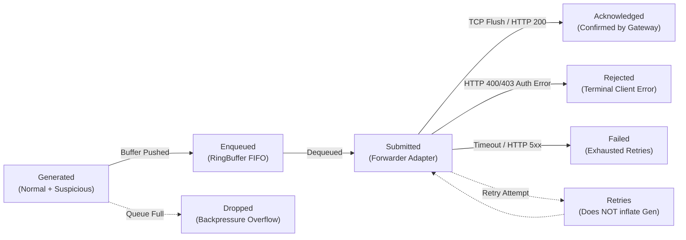
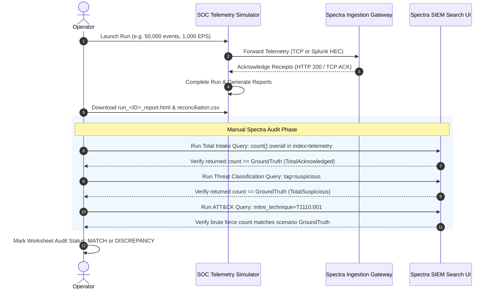

# Metrics Definition, Delivery Accounting & Spectra Reconciliation Guide

## 1. Accounting Invariants & Lifecycle States

The simulator tracks telemetry progression across seven strict atomic delivery states. A mathematical conservation check is evaluated after every run:

$$\text{TotalGenerated} = \text{TotalNormal} + \text{TotalSuspicious}$$
$$\text{TotalEnqueued} + \text{TotalDropped} \le \text{TotalGenerated}$$
$$\text{TotalSubmitted} \le \text{TotalEnqueued}$$
$$\text{TotalAcknowledged} + \text{TotalRejected} + \text{TotalFailed} + \text{TotalUnknown} \le \text{TotalSubmitted}$$

---

## 2. Complete Metric Definitions & Calculation Formulas

### 2.1 Generation Metrics

| Metric | Type | Calculation Formula / Source | Operational Significance |
| :--- | :--- | :--- | :--- |
| **`TotalGenerated`** | Counter (uint64) | $\sum \text{Events Synthesized by Generator Engine}$ | Ground-truth number of records created in memory. |
| **`TotalNormal`** | Counter (uint64) | $\sum \text{Routine Benign Events}$ | Routine baseline enterprise operations. |
| **`TotalSuspicious`** | Counter (uint64) | $\sum \text{MITRE ATT&CK Attack Scenario Events}$ | Injected threat emulation telemetry. |
| **`TargetEPS`** | Configured (int) | Specified via `cfg.Simulation.TargetEPS` or CLI `-eps` | Commanded throughput rate. |
| **`ActualEPS`** | Gauge (float64) | $\frac{\text{TotalGenerated}}{\text{RunDurationSeconds}}$ | Realized mean throughput across the entire run. |
| **`PeakEPS`** | Gauge (uint64) | $\max_{t} (\text{Generated}_{t} - \text{Generated}_{t-1\text{s}})$ | Maximum 1-second burst rate achieved. |
| **`MinEPS`** | Gauge (uint64) | $\min_{t} (\text{Generated}_{t} - \text{Generated}_{t-1\text{s}})$ | Minimum non-zero 1-second throughput observed. |

### 2.2 Forwarding & Delivery Metrics

| Metric | Type | Calculation Formula / Source | Operational Significance |
| :--- | :--- | :--- | :--- |
| **`TotalEnqueued`** | Counter (uint64) | $\sum \text{Pushed to In-Memory Ring Buffer}$ | Events staged for transmission. |
| **`TotalDropped`** | Counter (uint64) | $\sum \text{Dropped via DropOldest / DropNewest}$ | Backpressure drop count due to network saturation. |
| **`TotalSubmitted`** | Counter (uint64) | $\sum \text{Written to TCP Socket or HTTP Request}$ | Events passed across socket layer to receiver. |
| **`TotalAcknowledged`**| Counter (uint64) | TCP write/flush success or Splunk HEC HTTP 200 OK | Records accepted by the receiving SIEM gateway. |
| **`TotalRejected`** | Counter (uint64) | HTTP 400 Bad Request, 401/403 Invalid HEC Token | Permanent payload or authentication rejections. |
| **`TotalFailed`** | Counter (uint64) | Exhausted connection retries, HTTP 500, network drop | Network or remote server delivery crashes. |
| **`TotalRetries`** | Counter (uint64) | Network reconnects or HTTP 429/503 retry attempts | **Note:** Retries do *not* inflate `TotalGenerated`. |
| **`TotalUnknown`** | Counter (uint64) | Fire-and-forget UDP transports (if enabled) | Unconfirmable delivery protocols. |

---

## 3. The Spectra Ingestion & Delivery Invariant

> [!WARNING]
> **CRITICAL SIEM RECONCILIATION RULE:**
> A forwarding **Acknowledgement (ACK)** proves only that the simulator successfully transferred the payload across the network and received an acknowledgement from the Spectra ingestion gateway (TCP flush or HTTP 200 OK).
> 
> **An ACK DOES NOT prove that the event was:**
> 1. Indexed into a search database.
> 2. Normalized into standard data models.
> 3. Detected by a SIEM correlation rule or MITRE ATT&CK alert.
> 
> To verify true SIEM ingestion, the operator must execute the **Spectra Manual Reconciliation Worksheet**.

---

## 4. Spectra Manual Reconciliation Worksheet Workflow

Every simulation run automatically generates a post-run reconciliation worksheet available in the HTML, JSON, and CSV reports (`./reports/run_<ID>_reconciliation.csv`).

### Step-by-Step Operator Verification Workflow

### 4.1 Standardized Reconciliation Worksheet Structure

| Audit Category | Metric Name | Simulator Ground Truth | Recommended Spectra Search Query | Expected Tolerance | Verification Notes |
| :--- | :--- | :---: | :--- | :---: | :--- |
| **Intake Integrity** | Total Telemetry Events | `TotalAcknowledged` | `index=telemetry \| stats count` | 0% | Must equal total gateway ACKs. |
| **Classification** | Benign Activity | `TotalNormal` | `index=telemetry tag=normal \| stats count` | 0% | Verifies normal baseline tagging. |
| **Classification** | Suspicious Telemetry | `TotalSuspicious` | `index=telemetry tag=suspicious \| stats count` | 0% | Verifies threat flag detection. |
| **Source: Windows** | Windows Event Log | `BySource["windows_xml"]` | `index=telemetry source_type=windows_xml \| count` | 0% | Verifies XML parser ingestion. |
| **Source: Linux** | Linux Syslog | `BySource["linux_syslog"]`| `index=telemetry source_type=linux_syslog \| count` | 0% | Verifies Syslog parser ingestion. |
| **Source: Firewall**| Palo Alto PAN-OS CSV | `BySource["paloalto"]` | `index=telemetry source_type=paloalto \| count` | 0% | Verifies 54-column CSV parser. |
| **Source: DNS** | ISC BIND9 DNS | `BySource["bind9"]` | `index=telemetry source_type=bind9 \| count` | 0% | Verifies DNS query log parser. |
| **Adversary Emulation**| Brute Force (`T1110.001`)| `ByScenario["T1110.001"]`| `index=telemetry mitre_technique=T1110.001 \| count`| 0% | Verifies multi-stage attack intake. |
| **Adversary Emulation**| Port Scan (`T1046`) | `ByScenario["T1046"]` | `index=telemetry mitre_technique=T1046 \| count` | 0% | Verifies port scan rule trigger. |
| **Adversary Emulation**| DNS C2 (`T1071.004`) | `ByScenario["T1071.004"]`| `index=telemetry mitre_technique=T1071.004 \| count`| 0% | Verifies C2 domain lookup intake. |
| **Adversary Emulation**| Obfuscated PS (`T1059.001`)| `ByScenario["T1059.001"]`| `index=telemetry mitre_technique=T1059.001 \| count`| 0% | Verifies base64 command detection. |

---

## 5. Identifying & Triaging Reconciliation Discrepancies

If Spectra returns fewer events than the simulator ground truth:

1. **Intake Delta ($\text{GroundTruth} - \text{Spectra} > 0$):**
   - Check Spectra parser error logs (`index=_internal` or `/var/log/spectra/ingest.log`).
   - Look for malformed timestamp parsing or regex extraction timeouts.
2. **Threat Detection Delta:**
   - Confirm if Spectra SIEM correlation rules were enabled during the run duration.
   - Verify that the logical endpoint IP ranges (`10.0.1.0/24`, `10.0.2.0/24`) were mapped to the SIEM's "Internal Assets" list.
3. **Queue Drop Delta ($\text{TotalDropped} > 0$):**
   - Indicates simulator-side network backpressure. Increase forwarder worker pool or increase the destination receiver's socket buffer capacity.
