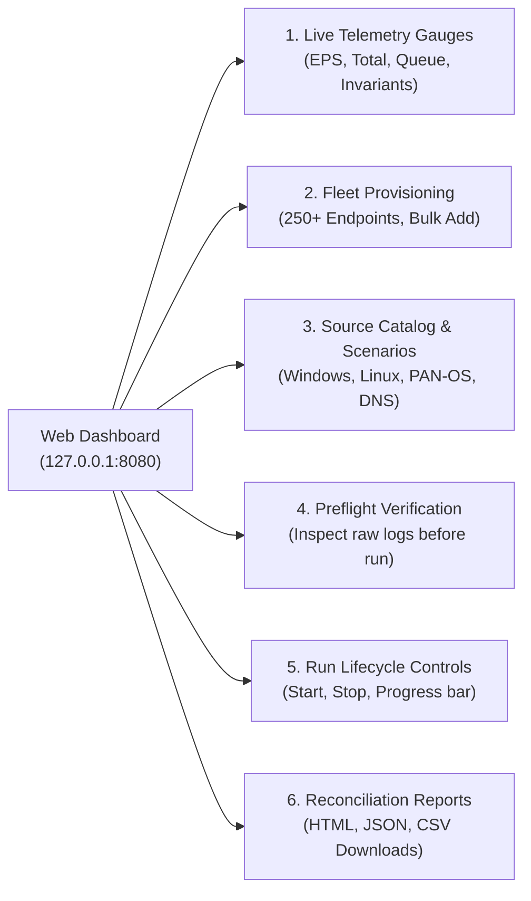

# Operator Guide, Configuration Reference & REST API Manual

## 1. Installation & Binary Build

The **SOC Telemetry Simulator** is built as a single, self-contained native executable with zero external runtime dependencies.

### Prerequisites
- Operating System: Windows 10/11 64-bit, Linux (kernel 4.x+), or macOS.
- Go Compiler: Go 1.24 or later.
- Virtualization: None required (**Zero Docker, Zero Podman, Zero VirtualBox/VMware**).

### Build Instructions

```powershell
# Clone the repository
git clone https://github.com/iaditya8/soc-telemetry-simulator.git
cd soc-telemetry-simulator

# Verify dependencies and run tests
go test -v ./...

# Build the optimized production binary
go build -ldflags="-s -w" -o bin/soc-sim.exe ./cmd/soc-sim

# Verify installation
.\bin\soc-sim.exe -version
```

---

## 2. CLI Operation Modes

The simulator supports four distinct execution modes via the `-mode` flag:

```text
Usage: soc-sim [flags]

Flags:
  -mode string
        Execution mode: run, server, receiver, benchmark (default "run")
  -config string
        Path to YAML configuration file (default "config.yaml")
  -eps int
        Override target EPS (events per second)
  -duration int
        Override run duration in seconds (0 = continuous until stopped)
  -receiver-tcp-port int
        Mock receiver TCP port (default 5140, 0 to disable)
  -receiver-hec-port int
        Mock receiver Splunk HEC port (default 8088, 0 to disable)
  -receiver-token string
        Optional required HEC token for mock receiver
  -version
        Display software version and exit
```

### 2.1 Mode: `run` (Headless CLI Simulation)
Executes a single simulation run according to `config.yaml`, streams events directly to the configured destination, and logs a real-time 1-second monitor to the console:
```powershell
.\bin\soc-sim.exe -mode run -eps 5000 -duration 60
```

### 2.2 Mode: `server` (Embedded Web Dashboard & REST API)
Launches the embedded management server at `http://127.0.0.1:8080`, hosting the interactive Single-Page Application (SPA), REST API, and WebSocket streaming telemetry hub:
```powershell
.\bin\soc-sim.exe -mode server -config config.yaml
```

### 2.3 Mode: `receiver` (Standalone Mock Spectra SIEM Receiver)
Launches an in-memory high-throughput mock ingestion receiver listening for streaming TCP/Syslog on port 5140 and Splunk HEC on port 8088:
```powershell
.\bin\soc-sim.exe -mode receiver -receiver-tcp-port 5140 -receiver-hec-port 8088
```

### 2.4 Mode: `benchmark` (100k+ EPS Hardware Validation)
Runs an automated stress test against the local rate pacing and generation engine, measuring throughput, GC cycles, and memory consumption:
```powershell
.\bin\soc-sim.exe -mode benchmark -eps 100000 -duration 10
```

---

## 3. Configuration Reference (`config.yaml`)

Below is a complete, annotated reference configuration:

```yaml
# Simulation Controls
simulation:
  target_eps: 10000              # Target generation throughput (Events Per Second)
  duration_seconds: 60          # Duration in seconds (0 = run continuously until stopped)
  normal_ratio: 0.85            # Proportion of routine benign enterprise events (85%)
  suspicious_ratio: 0.15        # Proportion of MITRE ATT&CK adversary events (15%)
  random_seed: 1337             # Deterministic PRNG seed (reproducible fleet & events)
  worker_count: 8               # Parallel generation worker routines

# Logical Fleet Architecture
fleet:
  total_endpoints: 250          # Total number of simulated logical endpoints
  domain: corp.internal         # Enterprise Active Directory domain name
  distribution:
    workstation: 0.60           # 60% Windows 10/11 Workstations (10.0.1.0/24)
    linux_server: 0.20          # 20% Linux DMZ Servers (10.0.2.0/24)
    internal_server: 0.10       # 10% Windows Server / Database / App (10.0.3.0/24)
    firewall: 0.05              # 5% Next-Gen Firewalls & Perimeter Gateways (10.0.4.0/24)
    domain_controller: 0.05     # 5% Active Directory Domain Controllers (10.0.5.0/24)

# Ingestion Destination
destination:
  transport: hec                # Transport adapter: "tcp" or "hec"
  host: 127.0.0.1               # Target host IP or hostname
  port: 8088                    # Target port (8088 for HEC, 5140 for TCP)
  tls_enabled: false            # Enable TLS encryption
  tls_skip_verify: true         # Allow self-signed certificates in lab environments
  auth_token: "secret-token"    # Authentication token (e.g. Splunk HEC token)
  batch_size: 500               # Max events aggregated per batch
  batch_timeout_ms: 100         # Max latency before flushing partial batches
  compression: true             # Enable gzip compression on HTTP payloads

# Forwarding Queue & Backpressure
queue:
  capacity: 65536               # Ring buffer capacity (powers of 2 recommended)
  backpressure_policy: drop_oldest # Overflow policy: "drop_oldest", "drop_newest", "block"
  flush_interval_ms: 50         # Background queue drain interval

# Delivery Ledger & Reports
ledger:
  ring_capacity: 1048576        # Event audit ring ledger capacity (32 bytes per entry)
  report_output_dir: ./reports  # Directory for post-run HTML, JSON, and CSV reports
  enable_xxhash: true           # Enable 64-bit payload fingerprinting

# Embedded Management Server
server:
  bind_address: 127.0.0.1       # Loopback interface only (security constraint)
  port: 8080                    # Management dashboard and REST API port
```

---

## 4. Embedded Web Dashboard User Guide

When running in `server` mode (`http://127.0.0.1:8080`), the embedded dashboard provides 6 functional sections:



1. **Top Status Bar & Run Controls:** Displays simulator state (`IDLE`, `RUNNING`, `STOPPING`, `COMPLETED`), Target EPS input, Duration input, and Start/Stop action buttons.
2. **Live Telemetry Gauges:** Real-time metrics streaming at 10 Hz over WebSocket: Current EPS, Total Generated, Total Acknowledged, Dropped, and Delivery Invariant status (`VALID`).
3. **Fleet Inventory Table:** Lists all synthesized endpoints with Hostname, IP Address, Subnet, Operating System, and Role. Includes a **Bulk Provisioning Modal** allowing operators to instantly synthesize $N$ devices of any type.
4. **Log Source Catalog & Format Selector:** Displays the 4 supported families, schema standards, and MITRE ATT&CK scenarios.
5. **Interactive Preflight Verification:** Allows operators to select any endpoint and generate an instant raw log preview (Windows XML, Linux Syslog, PAN-OS CSV, or BIND9 DNS) before initiating high-rate transmission.
6. **Reports & Spectra Reconciliation:** View post-run summaries and download comprehensive reports:
   - `run_<ID>_report.html`: Standalone self-contained HTML report with CSS charts and full accounting tables.
   - `run_<ID>_reconciliation.csv`: The standardized Spectra SIEM comparison worksheet.
   - `run_<ID>_report.json`: Machine-readable structured run metrics.

---

## 5. Management REST API & WebSocket Reference

The embedded server exposes a complete HTTP/JSON REST API bound strictly to `127.0.0.1`:

| Endpoint | HTTP Method | Description |
| :--- | :---: | :--- |
| `/api/health` | `GET` | Returns runtime health, simulator state, uptime, and Go version. |
| `/api/fleet` | `GET` | Returns the active fleet inventory and endpoint count. |
| `/api/fleet/bulk` | `POST` | Dynamically appends $N$ logical endpoints to the active fleet. |
| `/api/catalog` | `GET` | Returns supported source families, event types, and ATT&CK mappings. |
| `/api/preflight` | `GET` | Generates a single formatted raw log sample for preflight testing. |
| `/api/run/start` | `POST` | Launches a new simulation run with optional JSON config overrides. |
| `/api/run/stop` | `POST` | Gracefully halts an active simulation run and finalizes reports. |
| `/api/reports` | `GET` | Lists all generated run reports available on disk. |
| `/api/reports/download` | `GET` | Streams a specific report file (`?file=run_xxx.html`). |
| `/ws` / `/api/live/ws` | `GET (Upgrade)` | RFC 6455 WebSocket streaming live metrics at 10 Hz. |
| `/api/live/stream` | `GET` | Server-Sent Events (SSE) fallback stream for live metrics. |

### Example REST Interactions

#### 1. Preflight Verification Request
```bash
curl -X GET "http://127.0.0.1:8080/api/preflight?source=windows_xml&event_type=4624"
```
**Response (200 OK):**
```json
{
  "source": "windows_xml",
  "endpoint": "CORP-WKSTN-001.corp.internal",
  "ip": "10.0.1.10",
  "raw_log": "<Event xmlns='http://schemas.microsoft.com/win/2004/08/events/event'>...</Event>"
}
```

#### 2. Start Simulation Run Request
```bash
curl -X POST http://127.0.0.1:8080/api/run/start \
  -H "Content-Type: application/json" \
  -d '{"target_eps": 5000, "duration_seconds": 30, "suspicious_ratio": 0.20}'
```
**Response (200 OK):**
```json
{
  "run_id": "run_1731398400",
  "status": "RUNNING",
  "message": "Simulation run started successfully"
}
```
