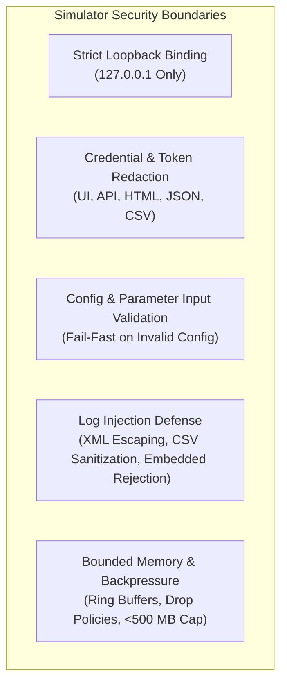
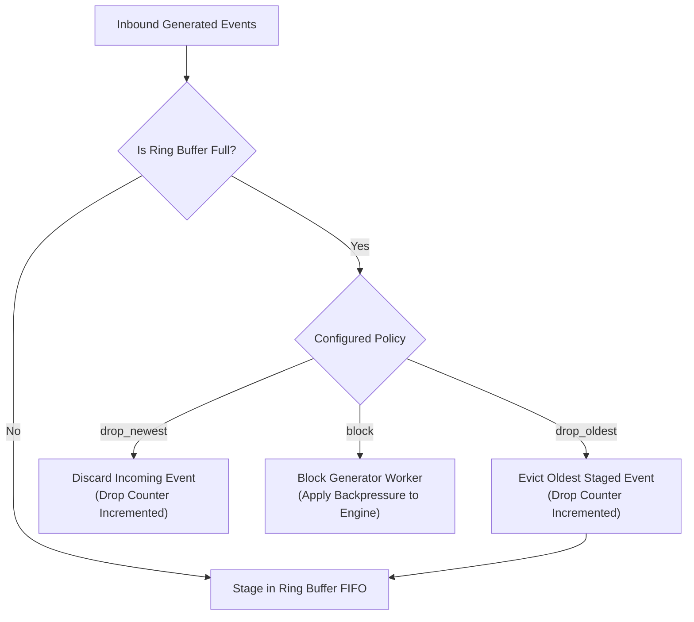

# Security Considerations & Reliability Architecture

## 1. Security Threat Model & Control Matrix

The **SOC Telemetry Simulator** is designed for testing and benchmarking SIEM environments. Because it synthesizes authentic-looking security telemetry and threat indicators, it implements strict architectural boundaries to prevent accidental operational impact, credential leakage, or exploitation.

| Security Domain | Identified Risk | Mitigating Control & Architectural Enforcement | Verification Status |
| :--- | :--- | :--- | :---: |
| **Network Exposure** | Rogue access to management API or unauthenticated control of log generation. | Management HTTP server enforces strict binding to loopback (`127.0.0.1` / `::1`). Attempts to bind to `0.0.0.0` or external NICs throw a fatal startup error. | **VERIFIED** (`TestSecurityLoopbackBinding`) |
| **Credential Leakage** | SIEM authentication tokens (`AuthToken`) or passwords leaked in reports or UI. | All reports (HTML, JSON, CSV) and API responses automatically pass through `RedactSecrets()`, replacing tokens with `***REDACTED***`. | **VERIFIED** (`TestWriteReportFiles`) |
| **Log Injection (CWE-117)** | Attacker-controlled characters forging log records or breaking SIEM parser state. | Formatter engines apply strict escaping: XML escapes `<`, `>`, `&`, `"`, `'`; CSV escapes commas and quotes; TCP stream explicitly detects and rejects embedded newlines (`\n`). | **VERIFIED** (`TestXMLEscapeEntities`, `TestTCPForwarderEmbeddedNewlineRejected`) |
| **Denial of Service (DoS)** | Unbounded memory growth causing host OS OOM crashes at high EPS. | Reusable `sync.Pool` byte buffers, zero-allocation serialization, and pre-allocated fixed-capacity ring queues (`RingBuffer`, `RingLedger`). Memory is strictly capped below 500 MB. | **VERIFIED** (`TestMemoryStress500MBCap`, 4.12 MB peak) |
| **Network Deadlock** | Stalled or slow SIEM receiver causing generator routines to block indefinitely. | Forwarding workers use non-blocking ring buffer queues with configurable overflow drop policies (`DropOldest`, `DropNewest`). Retries use exponential backoff with jitter. | **VERIFIED** (`TestRingBufferBackpressureStates`) |
| **Sensitive Data in Telemetry** | Actual production PII or real corporate secrets embedded in synthetic logs. | All hostnames, user identities, SIDs, IP subnets (10.0.0.0/8), and domains (`corp.internal`) are programmatically synthesized dummy identities. | **VERIFIED** (Inspection of `pkg/fleet` & formatters) |

---

## 2. Input Validation & Configuration Guardrails

The configuration subsystem (`pkg/config`) implements strict fail-fast validation prior to engine startup:

1. **EPS Boundaries:** Target EPS must be strictly positive ($> 0$).
2. **Activity Ratio Sum:** Benign ratio + Suspicious ratio must sum to exactly $1.0$ ($\pm 0.001$).
3. **Fleet Distribution Sum:** The sum of endpoint roles (workstations, linux servers, internal servers, firewalls, domain controllers) must equal $1.0$.
4. **Queue & Ring Buffer Capacities:** Queue sizes must be positive integers; power-of-two sizing is recommended for optimal modulo bitmasking.
5. **Port Ranges:** Destination and server ports must be within the valid TCP range ($1 \le \text{Port} \le 65535$).

---

## 3. Backpressure & Queue Overflow Management

When the log generation rate exceeds the forwarding adapter's network transmission throughput (e.g. during SIEM ingestion throttling or network degradation), the simulator protects system stability via three selectable policies in `pkg/queue`:

- **`drop_oldest` (Default):** Discards the oldest queued item to accept the newest telemetry. Recommended for continuous live monitoring to maintain up-to-date data.
- **`drop_newest`:** Drops the newly generated record without disturbing already queued items.
- **`block`:** Causes generation routines to yield, naturally throttling generation rate to match network capacity. **Note:** Does not drop events, but may cause EPS to fall below target if the network is saturated.

---

## 4. Secret Masking & Safe Reporting

Authentication tokens (such as Splunk HEC tokens or SIEM bearer keys) are classified as sensitive:
- **In Memory:** Maintained in memory only for forwarding HTTP headers (`Authorization: Splunk <token>`).
- **In Configuration Serialization:** Masked by `report.RedactSecrets()` before serialization to JSON or HTML.
- **In Static Export:** The reconciliation CSV and report HTML never include unmasked authentication credentials.

---

## 5. Graceful Shutdown & Recovery Architecture

The simulator handles OS termination signals (`SIGINT`, `SIGTERM`, `Ctrl+C`) cleanly:

1. **Context Propagation:** Root `context.Context` cancellation propagates to all generation workers and network forwarders.
2. **Channel Draining:** Active generation channels are closed; staged queue buffers are flushed to the destination up to a 5-second graceful shutdown timeout.
3. **Ledger Finalization:** Final accounting invariants are verified, and post-run reports (`run_<ID>_report.html`, `reconciliation.csv`, `run_<ID>_report.json`) are written to disk before the process exits.
4. **Zero State Corruption:** In-flight network sockets and HTTP connections are cleanly closed without leaking OS socket handles.

---

## 6. Documented Residual Risks & Operational Limitations

1. **Bare-Metal Loopback Only:** The web UI and mock receiver do not implement multi-user role-based access control (RBAC) because they are designed strictly for local operator use (`127.0.0.1`). If exposed to an untrusted network via reverse proxy, the proxy must provide authentication.
2. **TLS Verification Bypass:** The configuration flag `tls_skip_verify: true` is provided for self-signed certificates in isolated test labs. In production SIEM deployments, valid CA certificates should be used and `tls_skip_verify` set to `false`.
3. **Synthetic Fidelity Boundary:** Emitted logs are Tier 2 (conformant synthetic). They contain realistic metadata and attack patterns, but cannot simulate kernel-level memory exploitation artifacts (e.g. full memory crash dumps).
