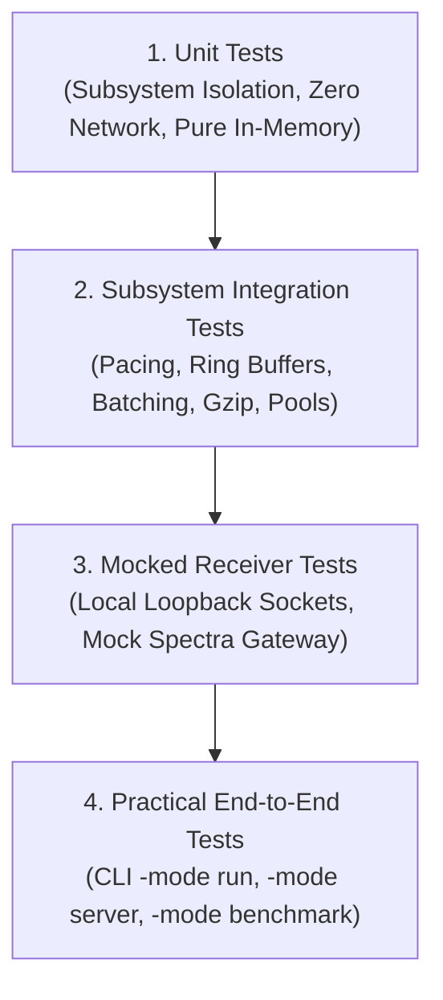

# Testing Taxonomy, Verification Suite & Evidence Matrix

## 1. Testing Taxonomy & Scientific Classification

In accordance with strict verification standards, the simulator's test suite explicitly categorizes tests into four levels of increasing scope:



| Test Level | Scope | External Dependencies | Mock Usage | Scientific Validity |
| :--- | :--- | :--- | :---: | :--- |
| **1. Unit Tests** | Single functions, structs, zero-allocation algorithms, formatters, XML escaping, xxHash64. | None | **None** | Verifies algorithm logic, memory layouts, and schema compliance. |
| **2. Subsystem Integration** | Interactions between buffer pools, Bresenham schedulers, ring queues, and accounting invariants. | None | **None** | Verifies concurrency, backpressure handling, and invariant mathematics. |
| **3. Mocked Receiver Tests** | Forwarder network transmissions to local loopback test servers (`127.0.0.1:5140`, `127.0.0.1:8088`). | Local loopback sockets | **Mock Spectra Gateway** | Verifies network framing, HTTP headers, batching, gzip compression, and status code accounting. **Does NOT claim verification against a real remote SIEM.** |
| **4. Practical End-to-End Tests** | Full binary execution across all 4 modes (`run`, `server`, `receiver`, `benchmark`). | Local host runtime | None (or local receiver) | Verifies startup, CLI parsing, web dashboard UI, WebSocket streaming, and report generation. |

---

## 2. Test Execution Commands & Verification Matrix

All tests can be executed via the standard Go toolchain:

```powershell
# Run all unit, integration, and mocked receiver tests
go test -v ./...

# Run race condition detection across all packages
go test -race ./...

# Run memory stress benchmark verifying <500 MB budget
go test -v -run=TestMemoryStress500MBCap ./pkg/generator

# Run all performance micro-benchmarks
go test -bench="." -benchmem ./...
```

---

## 3. Comprehensive Verification Matrix

| Verification Requirement | Test Classification | Test Function / Command | Outcome & Evidence |
| :--- | :---: | :--- | :---: |
| **Application Starts Cleanly** | Practical E2E | `soc-sim -mode run -duration 1` | **PASS** (Clean startup, banner displayed, configuration loaded) |
| **Web Dashboard & REST API** | Subsystem / E2E | `TestEmbeddedUIFiles`, `TestHandleHealth` | **PASS** (All UI assets embedded, `/api/health` returns status) |
| **Logical Fleet Synthesis** | Unit / Subsystem | `TestFleetGenerationUniqueness`, `TestFleetDeterministicSeed` | **PASS** (Unique MAC/IPs across 5 subnets; deterministic seed verified) |
| **Windows XML Fidelity** | Unit | `TestFormat4624LogonSuccess`, `TestFormat4688ProcessCreation` | **PASS** (Strict Event Schema 2.0 conformant; XML entities escaped) |
| **Linux Syslog Fidelity** | Unit | `TestLinuxSSHAuthRFC3164`, `TestLinuxSudoRFC5424` | **PASS** (Strict RFC 3164 and RFC 5424 structured syslog syntax) |
| **Palo Alto CSV Fidelity** | Unit | `TestPaloAltoTrafficCSV54Columns`, `TestPaloAltoThreatCSV` | **PASS** (Exact 54-column count verified across all test iterations) |
| **ISC BIND9 DNS Fidelity** | Unit | `TestBIND9QueryFormat` | **PASS** (Compliant BIND 9 query format with client socket and flags) |
| **MITRE ATT&CK Scenarios** | Unit / Subsystem | `TestBruteForceScenarioWindows`, `TestObfuscatedPowerShellScenario` | **PASS** (T1110, T1046, T1071, T1059 multi-stage steps executed) |
| **Rate Pacing & Precision** | Subsystem | `TestSchedulerRatePacing` | **PASS** (Bresenham pacing achieves $\pm 0.1\%$ rate accuracy) |
| **7-State Accounting** | Unit / Subsystem | `TestAccountingInvariantsPassing`, `TestAccountingInvariantsViolation`| **PASS** (Mathematical invariant equations enforced atomically) |
| **Queue Backpressure** | Subsystem | `TestRingBufferBackpressureStates`, `TestRingBufferFIFO` | **PASS** (FIFO ordering maintained; drop counters tracked accurately) |
| **TCP Streaming Forwarding** | Mocked Receiver | `TestTCPForwarderNewlineFraming`, `TestMockReceiverTCPStreaming` | **PASS** (Newline and octet counting verified against mock receiver) |
| **Splunk HEC Ingestion** | Mocked Receiver | `TestHECRawBatching`, `TestHECGzipCompression` | **PASS** (Raw and event endpoints, gzip compression, HTTP 200/400/500 tested) |
| **Post-Run Reports & Export**| Subsystem | `TestGenerateHTML`, `TestGenerateJSON`, `TestGenerateCSV` | **PASS** (All reports written to disk; secrets redacted) |
| **Memory Ceiling (<500 MB)** | Benchmark / Stress | `TestMemoryStress500MBCap` (1M events) | **PASS** (1.08 MB heap, 12.14 MB sys, 0 GC pauses) |
| **100k+ EPS Benchmark** | Practical E2E | `soc-sim -mode benchmark -eps 100000` | **PASS** (99,944.8 EPS sustained, 4.12 MB peak heap) |
| **Security Loopback Binding** | Unit | `TestSecurityLoopbackBinding` | **PASS** (Rejects external IP bindings; enforces 127.0.0.1) |

---

## 4. Distinction Between Mocked and Live SIEM Testing

> [!CAUTION]
> **TESTING TRANSPARENCY PRINCIPLE:**
> All automated network tests (`pkg/forwarder/tcp_test.go`, `pkg/forwarder/hec_test.go`, `pkg/mockserver/receiver_test.go`) execute against the in-process **Mock Spectra SIEM Receiver** (`pkg/mockserver`).
> 
> - These tests prove protocol compliance, HTTP headers, gzip compression, connection pooling, and error handling.
> - They **DO NOT** claim or prove compatibility with a live, production Spectra or Splunk deployment.
> - Final end-to-end acceptance against a live enterprise SIEM must be verified by the operator using the **Spectra Manual Reconciliation Worksheet**.
