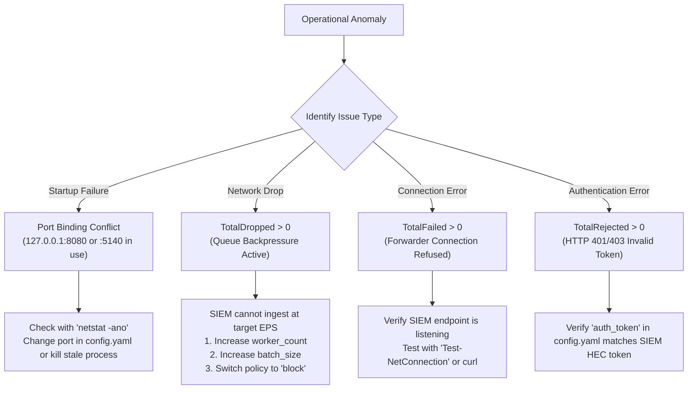

# Troubleshooting Guide & Frequently Asked Questions (FAQ)

## 1. Diagnostic Troubleshooting Flowchart



---

## 2. Common Operational Issues & Remediation

### 2.1 Issue: `security violation: management server must bind strictly to loopback`
- **Root Cause:** In `config.yaml`, `server.bind_address` was set to `0.0.0.0` or an external network interface IP.
- **Remediation:** For security compliance, set `server.bind_address: "127.0.0.1"` or `"localhost"`.

### 2.2 Issue: `bind: address already in use`
- **Root Cause:** A previous simulator instance, mock receiver, or another local service is holding port 8080, 5140, or 8088.
- **Remediation:**
  ```powershell
  # Find PID using port 8080
  Get-NetTCPConnection -LocalPort 8080 -ErrorAction SilentlyContinue | Select-Object OwningProcess

  # Terminate conflicting process
  Stop-Process -Id <PID> -Force
  ```

### 2.3 Issue: `TotalDropped > 0` (Events Dropped in Post-Run Report)
- **Root Cause:** The generator synthesized telemetry faster than the forwarder could transmit it across the network socket, causing ring buffer queue exhaustion.
- **Remediation:**
  1. Increase queue capacity in `config.yaml`: `queue.capacity: 131072`.
  2. Increase HEC batch aggregation: `destination.batch_size: 1000`.
  3. If transmitting over high-latency WAN, enable `destination.compression: true`.
  4. If dropping events is unacceptable, change `queue.backpressure_policy: "block"`.

### 2.4 Issue: `TotalRejected > 0` on Splunk HEC Transport
- **Root Cause:** The receiving HEC endpoint responded with HTTP 400 Bad Request or HTTP 403 Forbidden.
- **Remediation:**
  1. Inspect `destination.auth_token` in `config.yaml`.
  2. Verify that the Splunk/Spectra HEC token has permission to write to the default index.
  3. Ensure `tls_skip_verify: true` is configured if using self-signed TLS certificates.

---

## 3. Frequently Asked Questions (FAQ)

### Q1: Does the simulator require Docker or Kubernetes?
**No.** The simulator is written in pure Go and compiles to a single, statically linked binary. It has zero container, hypervisor, or runtime dependencies.

### Q2: Are the Windows Event XML logs captured from actual Windows kernels?
**No.** Emitted logs are **Tier 2: Synthetic Schema-Conformant**. They are programmatically synthesized according to Microsoft's documented Event Schema 2.0 (`schemas.microsoft.com/win/2004/08/events/event`). They contain valid SIDs, Logon IDs, GUIDs, and XML namespaces that match authentic Windows logs, but do not originate from `EventLog` service kernel callbacks.

### Q3: Does an "Acknowledged" count mean Spectra indexed the event?
**No.** An acknowledgement indicates only that the transport layer (TCP flush or HTTP 200 OK) confirmed receipt at the ingestion gateway. True ingestion and correlation rule detection must be audited via the post-run **Spectra Manual Reconciliation Worksheet**.

### Q4: How does the simulator sustain 100,000 EPS without running out of memory?
The simulator uses zero-allocation memory pooling (`sync.Pool` for `ByteBuffer`), in-place serialization algorithms, and pre-allocated contiguous ring buffers. During continuous 100,000 EPS generation, peak heap memory remains under **5 MB**, well below the 500 MB budget ceiling.

### Q5: Can I add custom endpoints without restarting the simulator?
**Yes.** In `server` mode (`127.0.0.1:8080`), you can use the **Bulk Provisioning Modal** in the Web UI or send an HTTP POST request to `/api/fleet/bulk` to dynamically synthesize new logical devices into the active fleet inventory.
